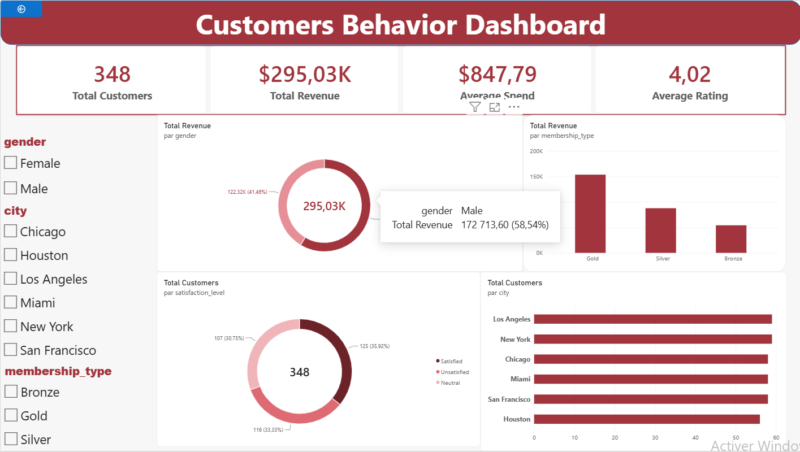

# 🛒 E-commerce Customer Behavior Analysis

An end-to-end data analysis project focused on understanding customer behavior, purchasing patterns, spending habits, and customer satisfaction using **Python, PostgreSQL, SQL, and Power BI**.

## 📌 Project Overview

The goal of this project is to analyze e-commerce customer data and extract meaningful business insights that can help businesses better understand their customers and make data-driven decisions.

The project follows a complete data analysis workflow, starting with data exploration and cleaning in Python, followed by database integration and SQL analysis using PostgreSQL, and finally creating an interactive dashboard using Power BI.

## 🎯 Project Objectives

- Analyze customer demographics and purchasing behavior.
- Understand customer spending patterns.
- Compare customer behavior across different cities and genders.
- Evaluate spending across different membership types.
- Analyze customer satisfaction and ratings.
- Investigate discount usage and purchasing activity.
- Build an interactive Power BI dashboard to visualize key performance indicators (KPIs).

## 📂 Dataset Description

The dataset initially contains **350 customer records and 11 columns**.

| Column | Description |
|---|---|
| Customer ID | Unique customer identifier |
| Gender | Customer gender |
| Age | Customer age |
| City | Customer location |
| Membership Type | Customer membership category |
| Total Spend | Total amount spent |
| Items Purchased | Number of purchased items |
| Average Rating | Customer average rating |
| Discount Applied | Whether a discount was applied |
| Days Since Last Purchase | Days since the last purchase |
| Satisfaction Level | Customer satisfaction category |

After data cleaning, the final dataset contains **348 records and 11 columns**.

## 🛠️ Tools & Technologies

| Tool | Purpose |
|---|---|
| Python | Data exploration and cleaning |
| Pandas | Data manipulation and preprocessing |
| PostgreSQL | Relational database management |
| SQL | Data querying and business analysis |
| SQLAlchemy | Python–PostgreSQL integration |
| Psycopg2 | PostgreSQL connectivity |
| Power BI | Interactive data visualization |
| DAX | Measures and KPI calculations |

## 🔄 Project Workflow

### 1. Data Exploration & Cleaning — Python

The first stage involved loading and exploring the dataset using Pandas.

Main tasks:
- Inspecting dataset structure and dimensions.
- Understanding column names and data types.
- Generating descriptive statistics.
- Checking missing values.
- Checking duplicate records.
- Removing incomplete records.
- Standardizing column names.
- Saving the cleaned dataset.

**Cleaning results:**
- Initial records: 350
- Missing records removed: 2
- Final records: 348
- Duplicate records identified: 0

### 2. Database Integration — PostgreSQL

The cleaned dataset was transferred from Python to PostgreSQL.

Main tasks:
- Creating a PostgreSQL database.
- Establishing a connection using SQLAlchemy and Psycopg2.
- Importing the cleaned DataFrame into a table named `customer`.
- Verifying the imported records using SQL queries.

### 3. Data Analysis — SQL

PostgreSQL was used to perform business-oriented analysis.

The analysis covered:

**Customer Analysis**
- Total number of customers.
- Customer distribution by gender.
- Customer distribution by city.

**Spending Analysis**
- Total customer spending.
- Average spending.
- Spending by membership type.
- Spending by satisfaction level.

**Purchasing Behavior**
- Average number of purchased items.
- Purchased items by gender.
- Customer purchasing activity.

**Discount Analysis**
- Number of customers receiving discounts.
- Discount distribution by gender.

**Customer Satisfaction**
- Satisfaction level distribution.
- Average rating by satisfaction category.
- Spending patterns across satisfaction groups.

### 4. Dashboard Development — Power BI

Power BI was connected directly to the PostgreSQL database to build an interactive customer overview dashboard.

**DAX Measures**

The following measures were created:

- Total Customers
- Unique Customers
- Total Revenue
- Average Spend
- Average Rating
- Total Items Purchased
- Average Items
- Average Customer Age
- Discount Customers
- Satisfied Customers
- Satisfaction Rate

**Dashboard Visualizations**

The dashboard includes:

- KPI Cards: Total Customers, Total Revenue, Average Spend, and Average Rating.
- Bar Chart: Customers by City.
- Column Chart: Revenue by Membership Type.
- Donut Chart: Customers by Gender.
- Donut Chart: Customers by Satisfaction Level.

**Interactive Filters (Slicers)**

- City
- Gender
- Membership Type

These slicers allow users to explore customer segments and dynamically filter dashboard visualizations.

## 📊 Dashboard Preview




## 📁 Project Structure

```text
ecommerce-customer-behavior-analysis/
│
├── data/
│   ├── E-commerce Customer Behavior.csv
│   │── E-commerce Customer Behavior Cleaned.csv
│
├── notebooks/
│   └── customers_bihavior_analysis.ipynb
│
├── sql/
│   └── customer_analysis.sql
│
├── powerbi/
│   └── Customers behavior dashboard.pbix
│
├── images/
│   └── customer_overview.png
│
├── README.md
└── requirements.txt
```

*Note: Update the filenames and folders to match your actual GitHub repository.*

## ⚙️ Installation & Usage

### 1. Clone the Repository

```bash
git clone YOUR_REPOSITORY_URL
cd ecommerce-customer-behavior-analysis
```

### 2. Install Python Dependencies

```bash
pip install -r requirements.txt
```

### 3. Configure PostgreSQL

- Install PostgreSQL.
- Create a database.
- Configure your database connection.
- Import the cleaned dataset into the `customer` table.

### 4. Run Python Analysis

Open the Jupyter Notebook and execute the data exploration and cleaning steps.

### 5. Execute SQL Queries

Connect to PostgreSQL and run the queries available in the `sql/` directory.

### 6. Open the Power BI Dashboard

Open the `.pbix` file using Power BI Desktop and configure the PostgreSQL connection if necessary.

## ⚠️ Project Limitations

- The dataset contains only 350 initial customer records.
- Transaction dates and detailed purchase history are unavailable.
- Monthly and seasonal sales trends cannot be analyzed.
- The analysis does not establish causal relationships between discounts, spending, and satisfaction.
- Findings are limited to the variables available in the dataset.

## 🚀 Key Learnings

Through this project, I gained practical experience in:

- Data exploration and preprocessing using Python.
- Handling missing values and checking data quality.
- Connecting Python applications to PostgreSQL.
- Writing SQL queries for business analysis.
- Creating DAX measures in Power BI.
- Designing interactive dashboards.
- Transforming raw data into business-oriented information.

## 👩‍💻 Author

**Hiba**

Data Analysis | Python | SQL | PostgreSQL | Power BI

---

*This project was developed as part of my practical learning journey in Data Analytics and Business Intelligence.*
